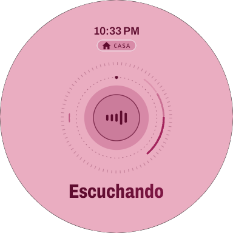
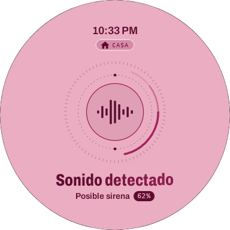
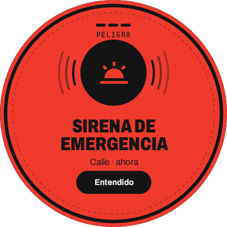
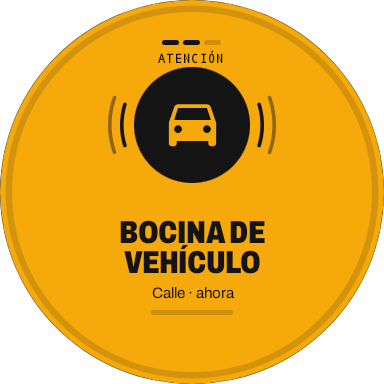
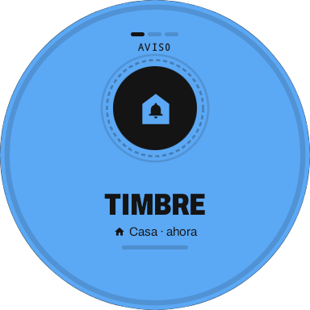
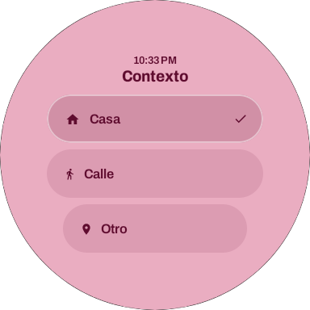
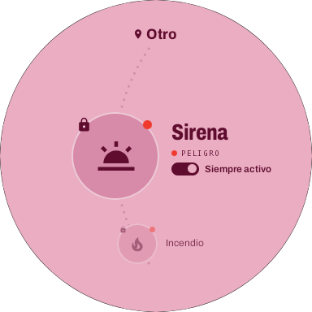
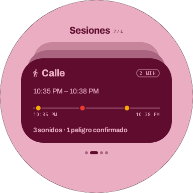
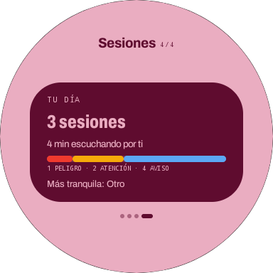
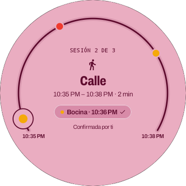

# Sound Alert

Sound Alert es una aplicación para **Wear OS** pensada para personas con dificultades auditivas. El reloj escucha el entorno, reconoce los sonidos importantes con inteligencia artificial y los convierte en **alertas visuales y vibraciones**, para que una sirena, un timbre o una bocina no pasen desapercibidos.

El repositorio tiene dos partes:

- [`wear/`](wear/): la app del reloj (escucha, IA, reglas, alertas e interfaz).
- [`backend/`](backend/): la API que guarda dispositivos, detecciones y alertas.

## Capturas de pantalla

Tomadas en el emulador `Wear_OS_Small_Round` con la zona horaria America/Bogota.

<table>
  <tr>
    <td align="center"><br><sub>Inicio: escuchando</sub></td>
    <td align="center"><br><sub>Analizando un sonido</sub></td>
    <td align="center"><br><sub>Alerta de peligro</sub></td>
    <td align="center"><br><sub>Alerta de atención</sub></td>
  </tr>
  <tr>
    <td align="center"><br><sub>Alerta de aviso</sub></td>
    <td align="center"><br><sub>Contexto</sub></td>
    <td align="center"><br><sub>Rueda de sonidos</sub></td>
    <td align="center"><br><sub>Historial de sesiones</sub></td>
  </tr>
  <tr>
    <td align="center"><br><sub>Tu día</sub></td>
    <td align="center"><br><sub>Detalle de sesión</sub></td>
    <td></td>
    <td></td>
  </tr>
</table>

## Cómo funciona

```
Micrófono → YAMNet (en el reloj) → sonido de Sound Alert → contexto + regla → nivel de alerta → pantalla y vibración
```

1. **Detectar.** Un servicio en primer plano de tipo micrófono escucha de forma continua, también con la pantalla apagada. Una puerta de energía evita analizar cuando solo hay silencio o ruido de fondo.
2. **Clasificar.** YAMNet analiza el audio y cada clase reconocida se traduce a uno de los sonidos de Sound Alert. Un estabilizador exige que el sonido se repita antes de darlo por bueno (ver [Cómo se decide una alerta](#cómo-se-decide-una-alerta)).
3. **Alertar.** El sonido, junto con el contexto activo, se busca en la tabla de reglas. Si tiene regla, se crea una alerta con su nivel: pantalla de color y vibración.

### Niveles de alerta

| Nivel | Color | Vibración | Cómo se cierra |
|-------|-------|-----------|----------------|
| **Peligro** | Rojo `#F03A2E` | 3 vibraciones largas (600 ms), que se repiten cada 15 s hasta confirmar | Solo con el botón **Entendido**; nunca se cierra sola |
| **Atención** | Ámbar `#F5A90A` | 2 vibraciones medianas (350 ms) | Con un toque o, sola, a los 10 s |
| **Aviso** | Azul `#5BA8F5` | 1 vibración corta (150 ms) | Con un toque o, sola, a los 5 s |

Entre pulsos hay una pausa de 250 ms. El número de barras de la pantalla de alerta (3, 2 o 1) coincide con el número de vibraciones.

### Contextos

El contexto indica **dónde está la persona**, no se deduce del sonido. Hay tres: **Casa**, **Calle** y **Otro** (este último es el predeterminado y vigila todos los sonidos). Cada contexto activa solo los sonidos que tienen sentido allí; por ejemplo, la bocina alerta en la calle pero no en casa. El contexto se elige desde el reloj y se conserva aunque la app se cierre o el reloj se reinicie.

Desde la **rueda de sonidos** se puede activar o desactivar cada sonido en cada contexto. Un sonido desactivado se sigue detectando, pero no alerta ni vibra.

### Historial por sesiones

La escucha se agrupa en **sesiones**: una sesión empieza al reanudar la escucha o al cambiar de contexto, y termina con el siguiente cambio o al pausar. Cada sonido detectado se anota en su sesión, haya alertado o no, junto con su nivel y si la persona lo confirmó. Las sesiones vacías de menos de un minuto se descartan.

- **Historial de sesiones:** tarjetas apiladas con las sesiones de hoy, de la más reciente a la más antigua, con su contexto, duración, horario, línea de tiempo y resumen.
- **Tu día:** número de sesiones, tiempo escuchando, alertas por nivel y la sesión más tranquila.
- **Detalle de sesión:** un arco del inicio al fin de la sesión con cada sonido en su minuto.

El historial se guarda en el propio reloj.

## Inteligencia artificial: YAMNet

YAMNet es un modelo preentrenado de clasificación de audio de Google, entrenado con el conjunto de datos **AudioSet**. Sound Alert usa la variante oficial de clasificación en formato TensorFlow Lite (`google/yamnet`, *classification*, versión 1), incluida en la app.

El modelo **se ejecuta en el reloj, sin internet**, con el runtime **LiteRT** (antes TensorFlow Lite) en la CPU. Recibe audio mono a **16 kHz** en ventanas de **15 600 muestras (0,975 s)**, con una ventana nueva cada **500 ms**, y devuelve una puntuación para cada clase.

El modelo completo reconoce **521 clases** de AudioSet (las 521 filas de [`yamnet_class_map.csv`](wear/app/src/main/assets/yamnet_class_map.csv)).

### Sonidos que reconoce Sound Alert

Sound Alert reconoce **21 sonidos**: **19 pueden generar alertas** y 2 (*Campana* y *Pitido*) son de **solo registro**, porque sus clases son demasiado genéricas: se detectan, pero nunca alertan ni vibran. Las demás clases de YAMNet (voz, música, aplausos, pasos…) se ignoran.

| Sonido en la app | Clases de YAMNet (AudioSet) | Nivel | Contextos activos por defecto |
|------------------|-----------------------------|-------|-------------------------------|
| Sirena | Siren, Civil defense siren, Police car (siren), Ambulance (siren), Fire engine, fire truck (siren), Emergency vehicle | 🔴 Peligro | Casa, Calle, Otro |
| Alarma de incendio | Fire alarm | 🔴 Peligro | Casa, Calle, Otro |
| Detector de humo | Smoke detector, smoke alarm | 🔴 Peligro | Casa, Calle, Otro |
| Alarma | Alarm | 🟡 Atención | Casa, Calle, Otro |
| Bocina de vehículo | Vehicle horn, car horn, honking · Air horn, truck horn · Toot | 🟡 Atención | Calle, Otro |
| Alarma de coche | Car alarm | 🟡 Atención | Calle, Otro |
| Frenazo | Skidding, Tire squeal | 🟡 Atención | Calle, Otro |
| Vehículo en marcha atrás | Reversing beeps | 🟡 Atención | Calle, Otro |
| Bocina de tren | Train horn, Train whistle | 🟡 Atención | Calle, Otro |
| Timbre de bicicleta | Bicycle bell | 🟡 Atención | Calle, Otro |
| Vidrio roto | Shatter | 🟡 Atención | Casa, Calle, Otro |
| Grito | Screaming | 🟡 Atención | Casa, Calle, Otro |
| Bebé llorando | Baby cry, infant cry | 🔵 Aviso | Casa, Otro |
| Perro ladrando | Bark | 🔵 Aviso | Casa, Calle, Otro |
| Timbre de puerta | Doorbell, Ding-dong | 🔵 Aviso | Casa, Otro |
| Golpe en la puerta | Knock | 🔵 Aviso | Casa, Otro |
| Teléfono sonando | Telephone bell ringing, Ringtone | 🔵 Aviso | Casa, Otro |
| Despertador | Alarm clock | 🔵 Aviso | Casa, Otro |
| Agua corriendo | Water tap, faucet | 🔵 Aviso | Casa, Otro |
| Campana | Bell, Church bell, Jingle bell, Chime | Solo registro | — |
| Pitido | Beep, bleep · Buzzer | Solo registro | — |

Las clases genéricas ceden ante las específicas: si en la misma ventana suenan *Alarm* y *Fire alarm*, cuenta solo la alarma de incendio; lo mismo ocurre con *Bell* frente al timbre de bicicleta o de puerta.

### Cómo se decide una alerta

- **Umbral de confianza.** Cada sonido tiene un umbral mínimo de puntuación de YAMNet. El general es **0,35**; la bocina usa **0,25**; la alarma genérica, la alarma de coche, el frenazo, la marcha atrás, la bocina de tren, el vidrio roto, el grito, la campana y el pitido usan **0,50**.
- **Estabilización.** Un sonido empieza cuando supera su umbral en **2 de las últimas 3 ventanas** (una ventana nueva cada 500 ms). Los sonidos de peligro tienen una vía rápida: basta **una sola ventana ≥ 0,60**. El vidrio roto, que es un sonido corto, también la tiene, con **≥ 0,70**.
- **Fin del sonido.** Termina cuando su puntuación queda por debajo de **0,15** durante **2 s** (**5 s** en los sonidos de peligro, porque una sirena que pasa tiene huecos). Un sonido sostenido genera una sola alerta.
- **Enfriamiento.** No se crea una alerta nueva de un sonido que ya tiene una alerta activa, ni antes de **10 s** desde su alerta anterior.

### Los sonidos de peligro no se pueden desactivar

Sirena, alarma de incendio y detector de humo son **Peligro en todos los contextos** y aparecen con un candado en la rueda de sonidos: no se pueden apagar.

## Stack tecnológico

### Reloj (Wear OS)

| Tecnología | Versión |
|------------|---------|
| Kotlin | 2.4.20 |
| Android Gradle Plugin | 9.4.1 |
| Gradle | 9.8.0 |
| Java (compatibilidad de compilación) | 17 |
| SDK mínimo | API 30 |
| SDK objetivo y de compilación | API 37 |
| Jetpack Compose (BOM) | 2026.09.00 |
| Compose for Wear OS (Material 3, Foundation, Navigation) | 1.7.0 |
| AndroidX Wear (modo ambiente) | 1.3.0 |
| AndroidX Activity Compose | 1.13.0 |
| AndroidX Lifecycle | 2.11.0 |
| AndroidX Core KTX | 1.19.1 |
| Kotlin Coroutines | 1.11.0 |
| LiteRT (runtime de YAMNet) | 2.2.0 |
| Modelo YAMNet (`google/yamnet`, *classification*, TFLite) | 1 |
| Pruebas: JUnit / AndroidX Test Runner / Espresso | 4.13.2 / 1.7.0 / 3.7.0 |

### Backend

| Tecnología | Versión |
|------------|---------|
| TypeScript | 6.0.3 |
| Node.js | *por completar* |
| NestJS (`@nestjs/core`, `@nestjs/platform-express`) | 12.1.2 |
| Swagger (`@nestjs/swagger`) | 12.0.2 |
| Configuración (`@nestjs/config`) | 12.0.1 |
| Validación (`class-validator` / `class-transformer`) | 0.15.1 / 0.5.1 |
| Base de datos | Supabase (PostgreSQL) |
| Cliente de base de datos (`@supabase/supabase-js`, sin ORM) | 2.117.2 |
| Pruebas: Vitest / Supertest | 4.1.11 / 7.3.0 |
| Calidad: oxlint / Prettier | 1.86.0 / 3.9.9 |

Las versiones del backend son las instaladas según `package-lock.json`.

## Despliegue

El backend está desplegado en **Railway** y la base de datos está en **Supabase**.

## Autora

**LauraEscobar1**
